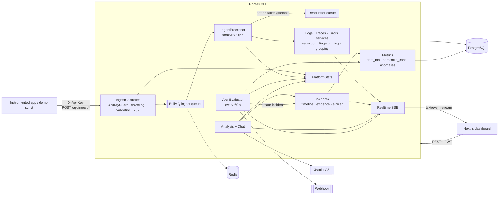
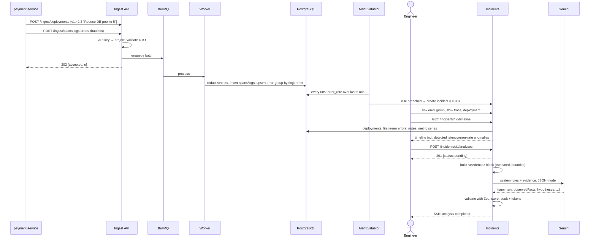

# AI Observability & Incident Response

## Overview

A developer-focused observability platform. Applications send **logs, spans, errors and deployment events** to an ingestion API using a project API key. The platform stores, groups and correlates them, then shows service health, distributed traces, grouped errors and anomalies. When something breaks, the engineer opens an **incident**: the platform builds a timeline automatically, collects linked evidence, finds similar past incidents, and asks **Gemini** for a structured analysis that keeps *observed facts* apart from *hypotheses*. Engineers can then follow up in an investigation chat.

It is not "a log viewer with a chatbot". The AI layer only ever sees **curated, structured evidence**, and its value comes from correlating several kinds of telemetry.

## Problem

During an incident, engineers jump between log search, APM, error tracking and the deploy history, then stitch the story together by hand: *what changed, when did latency start rising, which error is new, which span is slow?* Pasting raw logs into an LLM produces confident guesses that cannot be checked.

This platform:

- puts **errors → traces → logs → service → deployment** in one data model, linked through `traceId`, `spanId`, `requestId` and time,
- detects **anomalies against a baseline** and places them on a timeline next to deployments and first-seen errors,
- gives the LLM a **bounded, redacted evidence block** and requires a schema-validated answer that separates facts (each with its evidence) from hypotheses (each with a confidence level),
- never silently loses telemetry: ingestion goes through a **queue with retries and a dead-letter queue**.

**Who it is for:** backend developers, DevOps engineers and SREs who run services in production.

## Key features

- **Projects & API keys:** per-environment projects (`development`/`staging`/`production`). API keys look like `obs_…`, are stored only as SHA-256 hashes, show a visible prefix, and can be rotated.
- **Ingestion API:** `POST /ingest/{logs,spans,errors,deployments}` with batch payloads. Each call returns `202 Accepted` immediately, and a BullMQ worker persists the data.
- **Overview & services:** requests, error rate and P95 latency per project and per service, with a time-range selector and time-series charts (Postgres `date_bin` + `percentile_cont`).
- **Logs:** filter by time, service, level, endpoint, trace ID and request ID. Cursor-based pagination and a structured detail view.
- **Distributed traces:** span tree and waterfall (`server`/`client`/`internal` kinds) that makes bottlenecks obvious. Each span links to its logs.
- **Error tracking with grouping:** errors are fingerprinted (service + type + normalized message, with UUIDs, hex values and numbers stripped) and grouped into one issue with occurrence counts, first and last seen, and an `open → investigating → resolved` status.
- **Deployments:** tracked from ingestion or the UI and drawn as markers on metric charts.
- **Incidents:** severity, status, notes, and links to error groups, traces, deployments and logs. The **timeline is generated** from deployments, new errors, notes and detected latency or error-rate anomalies.
- **AI analysis:** an async Gemini call returns a JSON result (`summary`, `observedFacts[]`, `hypotheses[]` with confidence, `relatedDeployments[]`, `suggestedInvestigation[]`), validated with Zod and stored with token usage.
- **Investigation chat:** follow-up questions about the incident. Answers must cite evidence in brackets, e.g. `[deployment v1.42.3]`.
- **Similar incidents:** a weighted Jaccard similarity over error types, services and title words, with human-readable reasons.
- **Alerts:** rules on `error_rate`, `p95_latency` or `request_count` (`>` / `<` threshold over N minutes, optionally per service), evaluated every minute. Actions: auto-create an incident and/or call a webhook (with SSRF protection).
- **Realtime:** Server-Sent Events stream per project for new errors, incidents, alerts and analysis status.
- **Platform self-monitoring:** ingest latency, accepted/stored/retried/dead-lettered counts, queue depth, alert-run failures and AI failures.
- **Secret redaction:** passwords, tokens, JWTs, `Bearer` headers, API keys and credit card numbers (Luhn-checked) are masked before anything is stored.
- **Demo seeder:** `npm run demo` generates 3 hours of realistic traffic plus a bad deployment that triggers an incident.

## Tech stack

| Layer | Technology | Why |
|---|---|---|
| Frontend | Next.js 16 (App Router), React 19, Tailwind v4 | Server Components fetch per route. The JWT stays in an httpOnly cookie |
| Charts | Hand-built SVG components | Full control over deployment markers and anomaly highlights, with no chart dependency |
| Realtime | Server-Sent Events (`@Sse`) | Data flows one way, server to dashboard, so SSE is simpler than WebSockets and works over plain HTTP |
| Backend | NestJS 12 (ESM) | One module per domain: ingest, logs, traces, errors, metrics, incidents, analysis, alerts, platform |
| Storage | PostgreSQL + TypeORM | `jsonb` attributes, composite indexes on `(projectId, timestamp/traceId)`, SQL aggregates via QueryBuilder |
| Queue | BullMQ + Redis | Absorbs traffic spikes, survives DB outages (8 attempts with exponential backoff), and dead-letters what still fails |
| Scheduling | `@nestjs/schedule` | Alert evaluation loop every 60 s, guarded against overlapping runs |
| AI | Gemini via `@google/genai` | JSON output mode, validated against a Zod schema. `AnalysisModel` is an abstraction, so it can be swapped |
| Security | argon2, JWT, `@nestjs/throttler` | Separate rate limits for the dashboard API and ingestion (1200 req/min per key) |
| Tests | Vitest (unit + e2e against a real Postgres) | The e2e suite runs the whole investigation flow |

## Architecture



The ingest path and the query path are separate. Ingestion only authenticates, validates and enqueues, and returns `202` without waiting for the database. The worker reuses the same domain services as the rest of the app, so the public ingest contract did not change when the queue was introduced.

## Data flow: from a bad deploy to an AI analysis



## Database schema

```mermaid
erDiagram
  users ||--o{ projects : owns
  projects ||--o{ logs : has
  projects ||--o{ spans : has
  projects ||--o{ error_groups : has
  error_groups ||--o{ error_events : groups
  projects ||--o{ deployments : has
  projects ||--o{ incidents : has
  projects ||--o{ alert_rules : has
  incidents ||--o{ incident_links : "links evidence"
  incidents ||--o{ incident_notes : has
  incidents ||--o{ incident_analyses : has
  incidents ||--o{ incident_chat_messages : has
  users ||--o{ incident_notes : writes

  projects {
    uuid id PK
    uuid userId FK
    string name
    enum environment "development | staging | production"
    string apiKeyHash UK "sha256, never returned"
    string apiKeyPrefix "obs_xxxxxxxx"
    int lastIncidentNumber "per-project #numbering"
  }
  logs {
    uuid id PK
    uuid projectId FK
    string service
    enum level "debug | info | warn | error | fatal"
    text message
    timestamptz timestamp
    string traceId
    string spanId
    string requestId
    string endpoint
    jsonb attributes
  }
  spans {
    uuid id PK
    uuid projectId FK
    string traceId
    string spanId
    string parentSpanId
    string service
    string name
    enum kind "server | client | internal"
    enum status "ok | error"
    timestamptz startTime
    float durationMs
    jsonb attributes
  }
  error_groups {
    uuid id PK
    uuid projectId FK
    string fingerprint "unique per project"
    string type
    text message
    string service
    string endpoint
    enum status "open | investigating | resolved"
    int occurrences
    timestamptz firstSeen
    timestamptz lastSeen
  }
  error_events {
    uuid id PK
    uuid projectId FK
    uuid groupId FK
    string service
    text message
    text stackTrace
    timestamptz timestamp
    string traceId
    string spanId
    string requestId
    jsonb attributes
  }
  deployments {
    uuid id PK
    uuid projectId FK
    string version
    string service
    string commitSha
    text description
    timestamptz deployedAt
  }
  incidents {
    uuid id PK
    uuid projectId FK
    int number "unique per project"
    string title
    text description
    enum severity "low | medium | high | critical"
    enum status "open | investigating | resolved"
    uuid createdById FK
    timestamptz startedAt
    timestamptz resolvedAt
  }
  incident_links {
    uuid id PK
    uuid incidentId FK
    enum kind "error_group | trace | deployment | log"
    string targetId
  }
  incident_notes {
    uuid id PK
    uuid incidentId FK
    uuid authorId FK
    text body
  }
  incident_analyses {
    uuid id PK
    uuid incidentId FK
    uuid requestedById FK
    enum status "pending | completed | failed"
    string model
    jsonb result
    text error
    int inputTokens
    int outputTokens
  }
  incident_chat_messages {
    uuid id PK
    uuid incidentId FK
    enum role "user | assistant"
    text content
    uuid authorId FK
    string model
    int inputTokens
    int outputTokens
  }
  alert_rules {
    uuid id PK
    uuid projectId FK
    enum metric "error_rate | p95_latency | request_count"
    enum comparator "gt | lt"
    float threshold
    int windowMinutes
    string service
    bool createIncident
    enum incidentSeverity
    string webhookUrl
    enum status "ok | firing"
    float lastValue
  }
```



Correlation keys (`traceId`, `spanId`, `requestId`, `endpoint`, `service`) are shared across `logs`, `spans` and `error_events`, with composite indexes on `(projectId, traceId)` and `(projectId, timestamp)`. `incident_links` is a polymorphic link table, so one incident can collect any kind of evidence. The schema comes from 11 TypeORM migrations.

## API highlights

| Method | Route | Purpose |
|---|---|---|
| `POST` | `/api/ingest/logs` · `/spans` · `/errors` | Batch ingestion with `X-Api-Key`, returns `202` |
| `POST` | `/api/ingest/deployments` | Register a deployment from CI |
| `POST` | `/api/projects/:id/api-key/rotate` | Rotate the project key |
| `GET` | `/api/projects/:projectId/metrics/overview` · `/services` | Aggregated stats and time series |
| `GET` | `/api/projects/:projectId/logs` | Filtered, cursor-paginated logs |
| `GET` | `/api/projects/:projectId/traces/:traceId` | Full trace with the span tree |
| `GET/PATCH` | `/api/projects/:projectId/errors/:id` | Error group details and status |
| `GET` | `/api/projects/:projectId/incidents/:id/timeline` · `/evidence` · `/similar` | Investigation data |
| `POST` | `/api/projects/:projectId/incidents/:id/analyses` | Request an AI analysis (async) |
| `POST` | `/api/projects/:projectId/incidents/:id/chat` | Ask a follow-up question |
| `POST` | `/api/projects/:projectId/alerts/:id/evaluate` | Evaluate an alert rule on demand |
| `GET` | `/api/projects/:projectId/stream?token=…` | SSE event stream |
| `GET` | `/api/platform/stats` · `/api/health` | Self-monitoring and health |

**Example: ingesting an error**

```http
POST /api/ingest/errors
X-Api-Key: obs_3kq9…
Content-Type: application/json

{
  "errors": [{
    "service": "payment-service",
    "type": "DatabaseConnectionTimeout",
    "message": "Timed out acquiring a connection after 5000ms",
    "endpoint": "POST /payments",
    "traceId": "a1b2c3…",
    "attributes": { "db.pool.size": 5, "authorization": "Bearer eyJ…" }
  }]
}
```

```json
HTTP/1.1 202 Accepted
{ "accepted": 1 }
```

The stored event has `"authorization": "[REDACTED]"`, and it lands in the `DatabaseConnectionTimeout` group: the number `5000` is normalized away, so every timeout shares one fingerprint.

**Example: AI analysis result (`incident_analyses.result`)**

```json
{
  "summary": "POST /payments is failing with database connection timeouts that began shortly after deployment v1.42.3.",
  "observedFacts": [
    { "statement": "P95 latency rose from ~180ms to ~1.4s", "evidence": "timeline: latency anomaly at 14:04" },
    { "statement": "DatabaseConnectionTimeout occurred 1,842 times in payment-service", "evidence": "error group DatabaseConnectionTimeout" }
  ],
  "hypotheses": [
    { "cause": "Connection pool too small after v1.42.3", "confidence": "high", "reasoning": "Deployment description says the pool was reduced to 5; logs show 5/5 connections in use." }
  ],
  "relatedDeployments": ["v1.42.3"],
  "suggestedInvestigation": ["Compare pool settings between v1.42.2 and v1.42.3", "Check slow queries holding connections"]
}
```

<!-- TODO: replace with a real result from your demo run -->

## Example run

`npm run demo` creates a project called *My E-commerce API* and simulates 3 hours of traffic for `api` and `payment-service`:

1. **History:** deployments `v1.42.1` and `v1.42.2`, plus a resolved past incident, *"Database connection pool exhaustion"* (fixed by raising the pool from 5 to 20).
2. **Bad deploy:** `v1.42.3` on `payment-service`, *"Reduce database connection pool size to 5"*, 40 minutes ago.
3. **Degradation:** 4 minutes later, the PostgreSQL spans slow down and about 35% of `POST /payments` requests fail with `DatabaseConnectionTimeout`. Logs say *"Database pool exhausted (5/5 connections in use)"*.
4. **Overview** shows the error rate and P95 jumping right after the deployment marker. *(screenshot: overview.png)*
5. **Trace view** shows the slow PostgreSQL span dominating `POST /payments`. *(screenshot: trace.png)*
6. **Errors** shows a single grouped issue with its occurrence count instead of hundreds of separate 500s. *(screenshot: errors.png)*
7. **Incident:** "Payment API degraded" is linked to the error group, a slow trace and the deployment. The timeline shows *deploy → latency anomaly → error-rate anomaly → new error*. **Similar incidents** surfaces the old pool-exhaustion incident, citing *"Same error: DatabaseConnectionTimeout"* and *"Same service: payment-service"*. *(screenshot: incident.png)*
8. **AI analysis** names the pool reduction in v1.42.3 as a high-confidence *hypothesis*, not a confirmed cause, and suggests comparing pool configuration. *(screenshot: ai-analysis.png)*
9. **Chat:** *"What changed before the errors started?"* → the answer cites `[deployment v1.42.3]`.
10. The engineer resolves the incident, and it becomes searchable history for the next similar one.

## Key decisions & trade-offs

- **Structured evidence, not raw logs, for the LLM.** The prompt is built from linked entities and capped (50 timeline entries, 5 traces × 8 slowest spans, 50 logs, 500 characters per text field). It is cheap, deterministic and auditable, but the AI only knows what is linked to the incident.
- **Facts vs hypotheses in the schema itself.** The output must pass a Zod schema in which every fact carries evidence and every hypothesis carries a confidence level. Invalid output marks the analysis as `failed` instead of showing garbage.
- **Queue in front of storage.** Ingestion responds `202` and the worker retries 8 times with exponential backoff (starting at 2 s), then dead-letters. Data is eventually consistent, but no telemetry is lost during a database outage.
- **Postgres instead of a time-series DB.** `date_bin` + `percentile_cont` with composite indexes are enough at demo scale and keep a single datastore. ClickHouse/Timescale would be the next step at volume.
- **SSE instead of WebSockets.** The dashboard only receives data. SSE is simpler and works through plain HTTP infrastructure; the token goes in a query param because `EventSource` cannot set headers.
- **Explainable similarity instead of embeddings.** A weighted Jaccard (errors 0.5, services 0.3, title 0.2) produces reasons a human can verify.
- **Statistical anomaly detection.** The baseline is the median of the pre-incident window, and a spike requires both a ratio (×2) and an absolute increase (+200 ms, +5 pp). This avoids false alarms on tiny baselines.

## Challenges & solutions

- **Grouping noisy errors.** Messages contain IDs, durations and addresses that make every error unique. The fingerprint is a SHA-256 of service + type + a message with UUIDs, hex values and numbers normalized, so `Timed out after 5000ms` and `Timed out after 5012ms` fall into the same group.
- **Secrets inside telemetry.** Redaction runs in the domain services before storage, both on keys (`password`, `token`, `authorization`, `cookie`, …) and on values (JWTs, `Bearer` tokens, `obs_` keys, `key=value` query strings, Luhn-valid card numbers), recursively up to depth 10.
- **Prompt injection through logs.** Telemetry is untrusted user data. It is wrapped in `<evidence>` tags, and the system prompt forbids following instructions inside it.
- **SSRF through alert webhooks.** Before calling a webhook, the host is resolved and every address is checked against private, loopback, link-local and CGNAT ranges (IPv4 and IPv6). Webhook calls have a 5 s timeout.
- **Observing the observability platform.** `PlatformStats` keeps sliding windows of ingest latency and counts (accepted, stored, retried, dead-lettered), queue depth and failures, exposed through `/platform/stats` and the health checks.

## Testing & quality

- **Unit tests (Vitest):** fingerprinting, redaction, API keys, anomaly detection, request stats, time ranges, incident timeline, incident status, similarity scoring, alert evaluation, webhook SSRF checks, analysis and chat prompt builders, result parsing, ingest queue, platform stats, log cursor, trace tree, realtime.
- **E2E tests** against a real migrated Postgres. They cover project isolation, ingest + masking, degraded metrics, timeline + evidence, AI analysis + chat, and profile updates.
- oxlint + Prettier on the backend, ESLint + Vitest (form logic) on the frontend.
- <!-- TODO: add CI badge once GitHub Actions is configured -->

## Security

- Dashboard: JWT guard by default, argon2 password hashes, httpOnly cookie in the frontend.
- Ingestion: API key → SHA-256 lookup; the raw key is shown only once at creation or rotation.
- **Project isolation:** every query is scoped by `projectId`, and every project is checked against the requesting user.
- Rate limiting (`@nestjs/throttler`) with a separate, higher limit for ingestion.
- DTO validation with whitelisting on every endpoint.
- Secret redaction on ingest, SSRF protection for webhooks, prompt-injection guards for the AI.

## Running locally

Requirements: Node.js, PostgreSQL, Redis and a Gemini API key.

```bash
cd backend
cp .env.example .env            # DATABASE_URL, REDIS_URL, JWT_SECRET, GEMINI_API_KEY, GEMINI_MODEL
npm install
npm run migration:run
npm run start:dev               # http://localhost:3001/api
npm run demo                    # seeds demo user, project, telemetry and incidents

cd ../frontend
npm install
npm run dev                     # http://localhost:3000  (demo@example.com / demo-password)
```

## Limitations & roadmap

- No official SDK yet: telemetry is sent as plain JSON. Under consideration: **OTLP/HTTP ingestion**, so apps can connect through OpenTelemetry auto-instrumentation without code changes.
- Postgres as the telemetry store limits retention and volume; there is no retention policy or downsampling yet.
- Notifications: webhooks only, no Slack or PagerDuty.
- Future ideas: SLOs, uptime checks, AI-generated postmortems, automatic deployment correlation from GitHub.

## What I learned

- Designing an **ingestion pipeline** that decouples write acceptance from storage, with retries, a dead-letter queue and self-metrics.
- Writing **SQL aggregations** for time series (`date_bin`, `percentile_cont`) through a query builder with safe parameters.
- Using LLMs **responsibly** in an ops context: bounded evidence, schema-validated output, explicit uncertainty, citations.
- Security work specific to telemetry: **secret redaction, SSRF, prompt injection, tenant isolation**.
- Choosing **SSE over WebSockets** when the data only flows one way.
