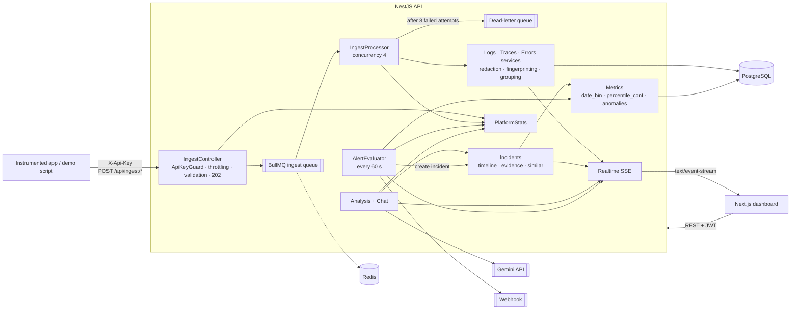
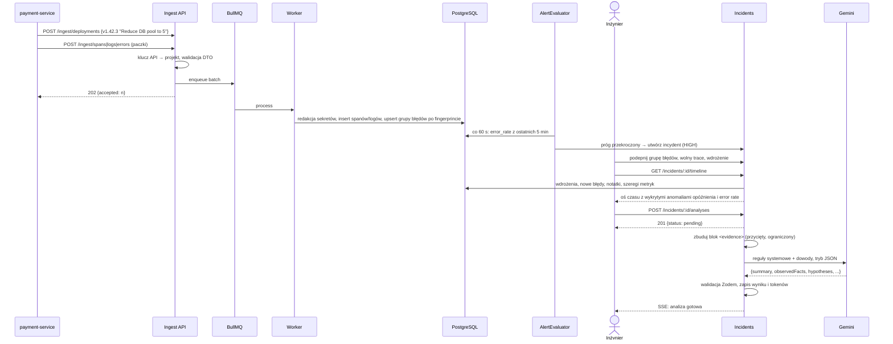
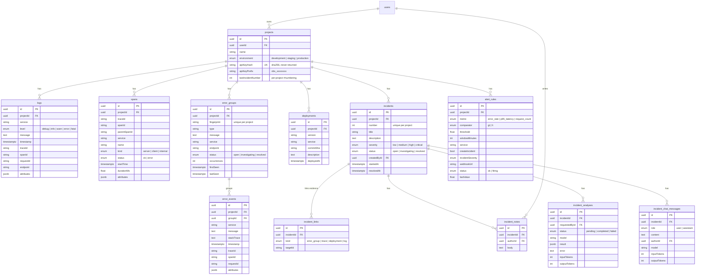

# AI Observability & Incident Response

## Opis

Platforma observability dla developerów. Aplikacje wysyłają **logi, spany, błędy i zdarzenia wdrożeń** do API ingestu, uwierzytelniając się kluczem API projektu. Platforma je zapisuje, grupuje i koreluje, a potem pokazuje zdrowie serwisów, rozproszone trace'y, pogrupowane błędy i anomalie. Gdy coś się psuje, inżynier otwiera **incydent**: platforma sama buduje oś czasu, zbiera podpięte dowody, znajduje podobne incydenty z przeszłości i prosi **Gemini** o ustrukturyzowaną analizę, w której *zaobserwowane fakty* są oddzielone od *hipotez*. Potem można dopytać w czacie dochodzeniowym.

To nie jest „przeglądarka logów z chatbotem”. Warstwa AI widzi wyłącznie **wyselekcjonowane, ustrukturyzowane dowody**, a wartość platformy bierze się z korelowania różnych rodzajów telemetrii.

## Problem

W trakcie incydentu inżynierowie skaczą między wyszukiwarką logów, APM, error trackingiem i historią wdrożeń, po czym ręcznie składają całą historię: *co się zmieniło, kiedy zaczęło rosnąć opóźnienie, który błąd jest nowy, który span jest wolny?* Wklejenie surowych logów do LLM daje pewne siebie zgadywanie, którego nie da się zweryfikować.

Ta platforma:

- łączy **błędy → trace'y → logi → serwis → wdrożenie** w jednym modelu danych przez `traceId`, `spanId`, `requestId` i czas,
- wykrywa **anomalie względem bazowego poziomu** i umieszcza je na osi czasu obok wdrożeń i nowych błędów,
- daje LLM **ograniczony, zredagowany blok dowodów** i wymaga odpowiedzi zgodnej ze schematem, która oddziela fakty (każdy z dowodem) od hipotez (każda z poziomem pewności),
- nigdy po cichu nie gubi telemetrii: ingest idzie przez **kolejkę z ponowieniami i dead-letter queue**.

**Dla kogo:** dla backend developerów, inżynierów DevOps i SRE utrzymujących serwisy na produkcji.

## Kluczowe funkcje

- **Projekty i klucze API:** projekty per środowisko (`development`/`staging`/`production`). Klucze mają postać `obs_…`, są przechowywane wyłącznie jako hash SHA-256, mają widoczny prefiks i można je rotować.
- **API ingestu:** `POST /ingest/{logs,spans,errors,deployments}` z paczkami danych. Każde wywołanie od razu zwraca `202 Accepted`, a zapisem zajmuje się worker BullMQ.
- **Przegląd i serwisy:** liczba żądań, error rate i P95 dla projektu i każdego serwisu, z wyborem zakresu czasu i wykresami szeregów czasowych (Postgres `date_bin` + `percentile_cont`).
- **Logi:** filtrowanie po czasie, serwisie, poziomie, endpoincie, trace ID i request ID. Paginacja kursorem i ustrukturyzowany widok szczegółów.
- **Rozproszone trace'y:** drzewo spanów i waterfall (rodzaje `server`/`client`/`internal`), w którym od razu widać wąskie gardła. Każdy span prowadzi do swoich logów.
- **Śledzenie błędów z grupowaniem:** każdy błąd dostaje fingerprint (serwis + typ + znormalizowany komunikat, z usuniętymi UUID, wartościami hex i liczbami) i trafia do jednej grupy z licznikiem wystąpień, pierwszym i ostatnim wystąpieniem oraz statusem `open → investigating → resolved`.
- **Wdrożenia:** rejestrowane przez ingest albo z UI i rysowane jako znaczniki na wykresach metryk.
- **Incydenty:** ważność, status, notatki i powiązania z grupami błędów, trace'ami, wdrożeniami i logami. **Oś czasu jest generowana** automatycznie z wdrożeń, nowych błędów, notatek i wykrytych anomalii opóźnienia oraz error rate.
- **Analiza AI:** asynchroniczne wywołanie Gemini zwraca wynik JSON (`summary`, `observedFacts[]`, `hypotheses[]` z poziomem pewności, `relatedDeployments[]`, `suggestedInvestigation[]`), walidowany Zodem i zapisywany razem z zużyciem tokenów.
- **Czat dochodzeniowy:** dopytywanie o incydent. Odpowiedzi muszą cytować dowody w nawiasach kwadratowych, np. `[deployment v1.42.3]`.
- **Podobne incydenty:** ważone podobieństwo Jaccarda po typach błędów, serwisach i słowach z tytułu, z czytelnym uzasadnieniem.
- **Alerty:** reguły na `error_rate`, `p95_latency` lub `request_count` (próg `>` / `<` w oknie N minut, opcjonalnie dla jednego serwisu), sprawdzane co minutę. Akcje: automatyczne utworzenie incydentu i/lub webhook (z ochroną przed SSRF).
- **Realtime:** strumień Server-Sent Events per projekt z nowymi błędami, incydentami, alertami i statusem analiz.
- **Monitorowanie samej platformy:** opóźnienie ingestu, liczba paczek przyjętych, zapisanych, ponowionych i przeniesionych do dead-letter queue, głębokość kolejki, błędy alertów i AI.
- **Redakcja sekretów:** hasła, tokeny, JWT, nagłówki `Bearer`, klucze API i numery kart (ze sprawdzeniem Luhna) są maskowane przed zapisem.
- **Generator demo:** `npm run demo` tworzy 3 godziny realistycznego ruchu plus wadliwe wdrożenie, które wywołuje incydent.

## Stack technologiczny

| Warstwa | Technologia | Dlaczego |
|---|---|---|
| Frontend | Next.js 16 (App Router), React 19, Tailwind v4 | Server Components pobierają dane per trasa. JWT zostaje w ciasteczku httpOnly |
| Wykresy | Własne komponenty SVG | Pełna kontrola nad znacznikami wdrożeń i wyróżnianiem anomalii, bez zależności od biblioteki wykresów |
| Realtime | Server-Sent Events (`@Sse`) | Dane płyną w jedną stronę (serwer → dashboard), więc SSE jest prostsze niż WebSockety i działa na zwykłym HTTP |
| Backend | NestJS 12 (ESM) | Jeden moduł na domenę: ingest, logs, traces, errors, metrics, incidents, analysis, alerts, platform |
| Storage | PostgreSQL + TypeORM | Atrybuty w `jsonb`, indeksy złożone na `(projectId, timestamp/traceId)`, agregaty SQL przez QueryBuilder |
| Kolejka | BullMQ + Redis | Amortyzuje skoki ruchu i przetrwa awarię bazy (8 prób z wykładniczym backoffem); co dalej nie przechodzi, trafia do dead-letter queue |
| Harmonogram | `@nestjs/schedule` | Pętla oceny alertów co 60 s, zabezpieczona przed nakładaniem się uruchomień |
| AI | Gemini przez `@google/genai` | Tryb wyjścia JSON z walidacją schematem Zod. `AnalysisModel` to abstrakcja, więc model da się podmienić |
| Bezpieczeństwo | argon2, JWT, `@nestjs/throttler` | Osobne limity zapytań dla API dashboardu i ingestu (1200 żądań/min na klucz) |
| Testy | Vitest (unit + e2e na prawdziwym Postgresie) | Testy e2e przechodzą cały scenariusz dochodzenia |

## Architektura



Ścieżka zapisu (ingest) i ścieżka odczytu są rozdzielone. Ingest tylko uwierzytelnia, waliduje i wrzuca paczkę do kolejki, po czym zwraca `202` bez czekania na bazę. Worker korzysta z tych samych serwisów domenowych co reszta aplikacji, więc publiczny kontrakt ingestu nie zmienił się po wprowadzeniu kolejki.

## Przepływ danych: od wadliwego wdrożenia do analizy AI



## Schemat bazy danych



Klucze korelacji (`traceId`, `spanId`, `requestId`, `endpoint`, `service`) są wspólne dla `logs`, `spans` i `error_events`, z indeksami złożonymi na `(projectId, traceId)` i `(projectId, timestamp)`. `incident_links` to polimorficzna tabela powiązań, więc jeden incydent może zebrać dowody dowolnego rodzaju. Schemat powstaje z 11 migracji TypeORM.

## Najważniejsze endpointy API

| Metoda | Trasa | Cel |
|---|---|---|
| `POST` | `/api/ingest/logs` · `/spans` · `/errors` | Ingest paczek z `X-Api-Key`, zwraca `202` |
| `POST` | `/api/ingest/deployments` | Rejestracja wdrożenia z CI |
| `POST` | `/api/projects/:id/api-key/rotate` | Rotacja klucza projektu |
| `GET` | `/api/projects/:projectId/metrics/overview` · `/services` | Zagregowane statystyki i szeregi czasowe |
| `GET` | `/api/projects/:projectId/logs` | Filtrowane logi z paginacją kursorem |
| `GET` | `/api/projects/:projectId/traces/:traceId` | Pełny trace z drzewem spanów |
| `GET/PATCH` | `/api/projects/:projectId/errors/:id` | Szczegóły i status grupy błędów |
| `GET` | `/api/projects/:projectId/incidents/:id/timeline` · `/evidence` · `/similar` | Dane do dochodzenia |
| `POST` | `/api/projects/:projectId/incidents/:id/analyses` | Zlecenie analizy AI (asynchronicznie) |
| `POST` | `/api/projects/:projectId/incidents/:id/chat` | Pytanie uzupełniające |
| `POST` | `/api/projects/:projectId/alerts/:id/evaluate` | Ręczna ocena reguły alertu |
| `GET` | `/api/projects/:projectId/stream?token=…` | Strumień zdarzeń SSE |
| `GET` | `/api/platform/stats` · `/api/health` | Monitorowanie platformy i health check |

**Przykład: ingest błędu**

```http
POST /api/ingest/errors
X-Api-Key: obs_3kq9…
Content-Type: application/json

{
  "errors": [{
    "service": "payment-service",
    "type": "DatabaseConnectionTimeout",
    "message": "Timed out acquiring a connection after 5000ms",
    "endpoint": "POST /payments",
    "traceId": "a1b2c3…",
    "attributes": { "db.pool.size": 5, "authorization": "Bearer eyJ…" }
  }]
}
```

```json
HTTP/1.1 202 Accepted
{ "accepted": 1 }
```

Zapisane zdarzenie ma `"authorization": "[REDACTED]"` i trafia do grupy `DatabaseConnectionTimeout`: liczba `5000` jest normalizowana, więc wszystkie timeouty mają wspólny fingerprint.

**Przykład: wynik analizy AI (`incident_analyses.result`)**

```json
{
  "summary": "POST /payments is failing with database connection timeouts that began shortly after deployment v1.42.3.",
  "observedFacts": [
    { "statement": "P95 latency rose from ~180ms to ~1.4s", "evidence": "timeline: latency anomaly at 14:04" },
    { "statement": "DatabaseConnectionTimeout occurred 1,842 times in payment-service", "evidence": "error group DatabaseConnectionTimeout" }
  ],
  "hypotheses": [
    { "cause": "Connection pool too small after v1.42.3", "confidence": "high", "reasoning": "Deployment description says the pool was reduced to 5; logs show 5/5 connections in use." }
  ],
  "relatedDeployments": ["v1.42.3"],
  "suggestedInvestigation": ["Compare pool settings between v1.42.2 and v1.42.3", "Check slow queries holding connections"]
}
```

<!-- TODO: podmienić na prawdziwy wynik z uruchomienia demo -->

## Przykładowy przebieg

`npm run demo` tworzy projekt *My E-commerce API* i symuluje 3 godziny ruchu dla `api` i `payment-service`:

1. **Historia:** wdrożenia `v1.42.1` i `v1.42.2` oraz rozwiązany incydent z przeszłości *„Database connection pool exhaustion”* (naprawiony podniesieniem puli z 5 do 20 połączeń).
2. **Wadliwe wdrożenie:** `v1.42.3` na `payment-service`, *„Reduce database connection pool size to 5”*, 40 minut temu.
3. **Degradacja:** 4 minuty później spany PostgreSQL zwalniają, a około 35% żądań `POST /payments` kończy się błędem `DatabaseConnectionTimeout`. W logach pojawia się *„Database pool exhausted (5/5 connections in use)”*.
4. **Przegląd** pokazuje skok error rate i P95 tuż za znacznikiem wdrożenia. *(screen: overview.png)*
5. **Widok trace'a** pokazuje, że w `POST /payments` dominuje wolny span PostgreSQL. *(screen: trace.png)*
6. **Błędy** pokazują jedną grupę z licznikiem wystąpień zamiast setek osobnych błędów 500. *(screen: errors.png)*
7. **Incydent:** „Payment API degraded” ma podpiętą grupę błędów, wolny trace i wdrożenie. Oś czasu pokazuje *wdrożenie → anomalia opóźnienia → anomalia error rate → nowy błąd*. **Podobne incydenty** wyciągają stary incydent z wyczerpaniem puli, z uzasadnieniem *„Same error: DatabaseConnectionTimeout”* i *„Same service: payment-service”*. *(screen: incident.png)*
8. **Analiza AI** wskazuje zmniejszenie puli w v1.42.3 jako *hipotezę* o wysokiej pewności, a nie potwierdzoną przyczynę, i proponuje porównanie konfiguracji puli. *(screen: ai-analysis.png)*
9. **Czat:** *„Co się zmieniło, zanim zaczęły się błędy?”* → odpowiedź cytuje `[deployment v1.42.3]`.
10. Inżynier rozwiązuje incydent, który staje się przeszukiwalną historią przy następnym podobnym problemie.

## Kluczowe decyzje i kompromisy

- **Ustrukturyzowane dowody zamiast surowych logów dla LLM.** Prompt powstaje z podpiętych encji i ma limity (50 wpisów osi czasu, 5 trace'ów × 8 najwolniejszych spanów, 50 logów, 500 znaków na pole tekstowe). Jest tani, deterministyczny i audytowalny, ale AI wie tylko to, co podpięto do incydentu.
- **Fakty vs hipotezy w samym schemacie.** Wynik musi przejść schemat Zod, w którym każdy fakt ma dowód, a każda hipoteza poziom pewności. Niepoprawny wynik oznacza analizę jako `failed`, zamiast pokazywać śmieci.
- **Kolejka przed zapisem.** Ingest odpowiada `202`, a worker ponawia zapis 8 razy z wykładniczym backoffem (od 2 s), po czym przenosi paczkę do dead-letter queue. Dane są spójne ostatecznie (eventual consistency), ale awaria bazy nie gubi telemetrii.
- **Postgres zamiast bazy szeregów czasowych.** `date_bin` + `percentile_cont` z indeksami złożonymi wystarczają w skali demo i pozwalają trzymać jeden magazyn danych. Przy dużym wolumenie następnym krokiem byłby ClickHouse lub Timescale.
- **SSE zamiast WebSocketów.** Dashboard tylko odbiera dane. SSE jest prostsze i działa przez zwykłą infrastrukturę HTTP; token idzie w parametrze zapytania, bo `EventSource` nie ustawia nagłówków.
- **Wyjaśnialne podobieństwo zamiast embeddingów.** Ważony Jaccard (błędy 0.5, serwisy 0.3, tytuł 0.2) daje uzasadnienia, które człowiek może sprawdzić.
- **Statystyczne wykrywanie anomalii.** Poziom bazowy to mediana z okna przed incydentem, a skok wymaga jednocześnie krotności (×2) i bezwzględnego wzrostu (+200 ms, +5 pp). Dzięki temu nie ma fałszywych alarmów przy bardzo niskim poziomie bazowym.

## Wyzwania i rozwiązania

- **Grupowanie zaszumionych błędów.** Komunikaty zawierają ID, czasy i adresy, przez które każdy błąd wygląda inaczej. Fingerprint to SHA-256 z serwisu, typu i komunikatu ze znormalizowanymi UUID, wartościami hex i liczbami, więc `Timed out after 5000ms` i `Timed out after 5012ms` trafiają do tej samej grupy.
- **Sekrety w telemetrii.** Redakcja działa w serwisach domenowych przed zapisem, zarówno po kluczach (`password`, `token`, `authorization`, `cookie`, …), jak i po wartościach (JWT, tokeny `Bearer`, klucze `obs_`, query stringi `key=value`, numery kart poprawne według Luhna), rekurencyjnie do głębokości 10.
- **Prompt injection przez logi.** Telemetria to niezaufane dane użytkownika. Jest opakowana w tagi `<evidence>`, a prompt systemowy zabrania wykonywania poleceń znalezionych w środku.
- **SSRF przez webhooki alertów.** Przed wywołaniem webhooka host jest rozwiązywany, a każdy adres sprawdzany względem zakresów prywatnych, loopback, link-local i CGNAT (IPv4 i IPv6). Wywołania webhooków mają timeout 5 s.
- **Monitorowanie platformy observability.** `PlatformStats` trzyma przesuwne okna opóźnień ingestu i liczników (przyjęte, zapisane, ponowione, przeniesione do dead-letter queue), głębokość kolejki i błędy, udostępnione przez `/platform/stats` i health checki.

## Testy i jakość

- **Testy jednostkowe (Vitest):** fingerprinting, redakcja, klucze API, wykrywanie anomalii, statystyki żądań, zakresy czasu, oś czasu i status incydentu, podobieństwo, ocena alertów, ochrona webhooków przed SSRF, budowanie promptów analizy i czatu, parsowanie wyniku, kolejka ingestu, statystyki platformy, kursor logów, drzewo trace'a, realtime.
- **Testy E2E** na prawdziwym, zmigrowanym Postgresie. Obejmują izolację projektów, ingest z maskowaniem, zdegradowane metryki, oś czasu z dowodami, analizę AI z czatem i edycję profilu.
- oxlint + Prettier na backendzie, ESLint + Vitest (logika formularzy) na frontendzie.
- <!-- TODO: dodać badge CI po skonfigurowaniu GitHub Actions -->

## Bezpieczeństwo

- Dashboard: guard JWT domyślnie, hasła hashowane argon2, ciasteczko httpOnly na frontendzie.
- Ingest: klucz API → wyszukiwanie po SHA-256; surowy klucz jest pokazywany tylko raz, przy utworzeniu lub rotacji.
- **Izolacja projektów:** każde zapytanie jest zawężone do `projectId`, a każdy projekt sprawdzany względem użytkownika, który o niego pyta.
- Limity zapytań (`@nestjs/throttler`), z osobnym, wyższym limitem dla ingestu.
- Walidacja DTO z whitelistą na każdym endpoincie.
- Redakcja sekretów przed zapisem, ochrona webhooków przed SSRF, zabezpieczenia AI przed prompt injection.

## Uruchomienie lokalne

Wymagania: Node.js, PostgreSQL, Redis i klucz API Gemini.

```bash
cd backend
cp .env.example .env            # DATABASE_URL, REDIS_URL, JWT_SECRET, GEMINI_API_KEY, GEMINI_MODEL
npm install
npm run migration:run
npm run start:dev               # http://localhost:3001/api
npm run demo                    # tworzy użytkownika demo, projekt, telemetrię i incydenty

cd ../frontend
npm install
npm run dev                     # http://localhost:3000  (demo@example.com / demo-password)
```

## Ograniczenia i plany

- Nie ma jeszcze oficjalnego SDK: telemetria idzie jako zwykły JSON. Rozważany kierunek: **ingest OTLP/HTTP**, żeby aplikacje mogły się podłączyć przez auto-instrumentację OpenTelemetry bez zmian w kodzie.
- Postgres jako magazyn telemetrii ogranicza retencję i wolumen; nie ma jeszcze polityki retencji ani downsamplingu.
- Powiadomienia: tylko webhooki, bez Slacka i PagerDuty.
- Pomysły na przyszłość: SLO, monitoring dostępności, postmortemy generowane przez AI, automatyczna korelacja wdrożeń z GitHuba.

## Czego się nauczyłem

- Projektowania **pipeline'u ingestu**, który oddziela przyjęcie danych od zapisu, z ponowieniami, dead-letter queue i własnymi metrykami.
- Pisania **agregacji SQL** dla szeregów czasowych (`date_bin`, `percentile_cont`) przez query builder z bezpiecznymi parametrami.
- **Odpowiedzialnego** używania LLM w kontekście operacyjnym: ograniczone dowody, wynik walidowany schematem, jawna niepewność, cytowanie źródeł.
- Bezpieczeństwa specyficznego dla telemetrii: **redakcja sekretów, SSRF, prompt injection, izolacja tenantów**.
- Wybierania **SSE zamiast WebSocketów**, gdy dane płyną tylko w jedną stronę.
